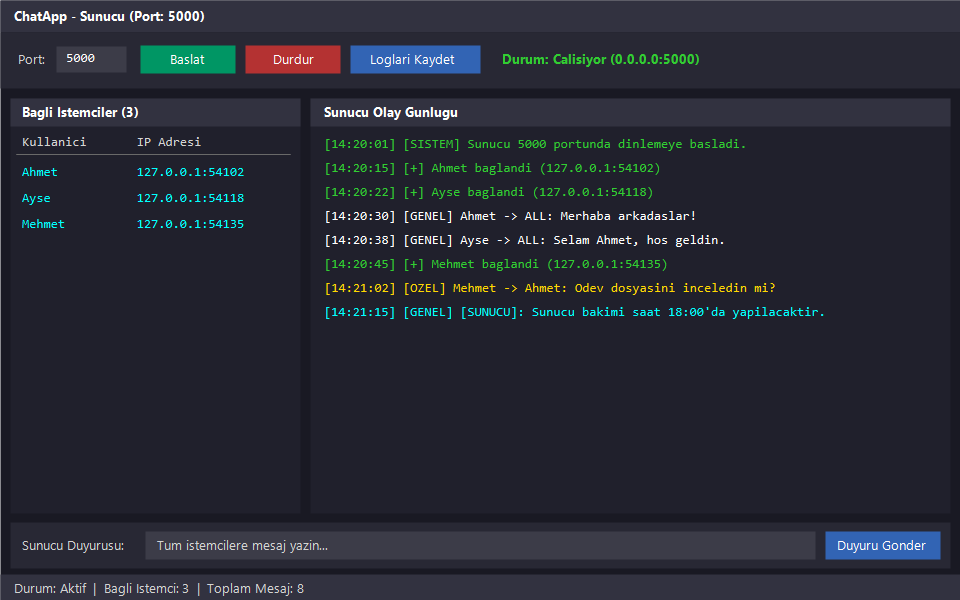
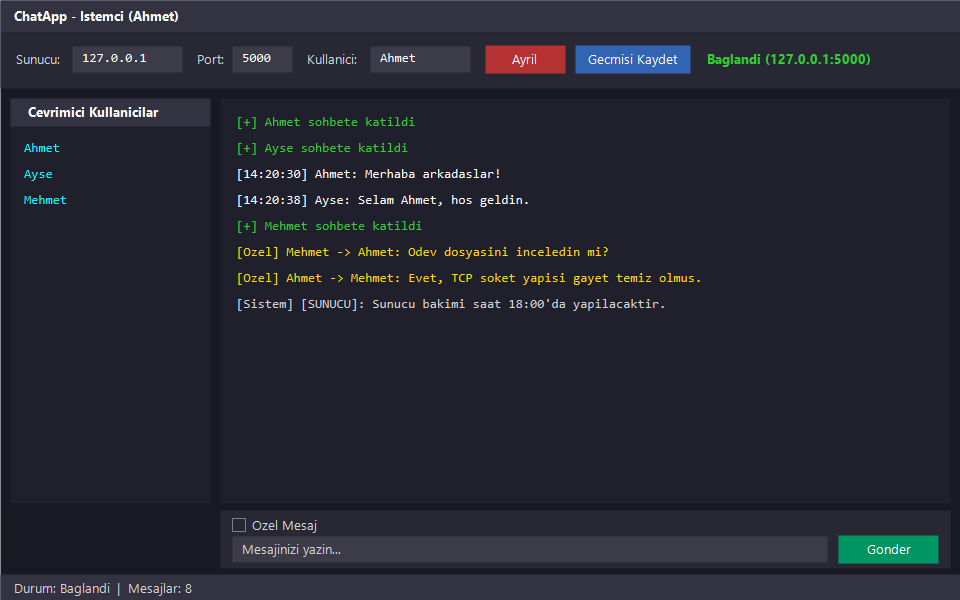

# YMH 219 - TCP/IP Çoklu İstemcili Sohbet Uygulaması (ChatApp)

**Ders:** YMH 219 - Nesne Tabanlı Programlama (C# .NET 8.0 WinForms)  
**Geliştirici:** [agumusfu](https://github.com/agumusfu)

---

## Proje Hakkında

Bu proje, `System.Net.Sockets` (`TcpListener` ve `TcpClient`) ve `System.IO` (`StreamReader` / `StreamWriter`) sınıfları kullanılarak geliştirilmiş, çoklu istemci destekli asenkron bir TCP/IP Masaüstü Sohbet Uygulamasıdır.

Uygulama; ortak veri modellerini barındıran **Core**, bağlantıları yöneten **Server** ve kullanıcıların sohbet ettiği **Client** olmak üzere 3 katmanlı temiz bir mimariyle tasarlanmıştır.

---

## Ekran Görüntüleri

### Sunucu Uygulaması (`ChatApp.Server`)


### İstemci Uygulaması (`ChatApp.Client`)


---

## Mimari ve Proje Yapısı

```text
YMH219-ChatApp/
├── YMH219-ChatApp.sln
├── docs/
│   └── screenshots/
│       ├── server_running.png
│       └── client_chat.png
└── src/
    ├── ChatApp.Core/                 # Ortak sınıf kütüphanesi (net8.0)
    │   ├── Models/
    │   │   ├── ChatMessage.cs        # JSON serileştirilebilir TCP mesaj modeli & MessageType enum
    │   │   └── ConnectedClientInfo.cs# Bağlı istemci bilgileri
    │   └── Services/
    │       └── ChatHistoryService.cs # StreamWriter ile .txt sohbet geçmişi dışa aktarım servisi
    ├── ChatApp.Server/               # Sunucu WinForms uygulaması (net8.0-windows)
    │   ├── Services/
    │   │   └── TcpChatServer.cs      # ConcurrentDictionary tabanlı çoklu istemci TCP sunucusu
    │   ├── ServerForm.cs
    │   ├── ServerForm.Designer.cs
    │   └── Program.cs
    └── ChatApp.Client/               # İstemci WinForms uygulaması (net8.0-windows)
        ├── Services/
        │   └── TcpChatClient.cs      # Asenkron TcpClient bağlantı ve mesaj dinleme motoru
        ├── ClientForm.cs
        ├── ClientForm.Designer.cs
        └── Program.cs
```

---

## Temel Özellikler

- **Çoklu İstemci Desteği:** Sunucu, `ConcurrentDictionary` ve `async/await` kullanarak aynı anda birden fazla istemciyi engellemesiz (non-blocking) şekilde yönetir.
- **Genel (Broadcast) & Özel (Private DM) Mesajlaşma:** İstemciler tüm odaya mesaj gönderebildiği gibi çevrimiçi listeden seçtiği tek bir kullanıcıya özel mesaj da iletebilir.
- **Canlı Kullanıcı Listesi Senkronizasyonu:** Bir kullanıcı katıldığında veya ayrıldığında `UserList` paketiyle tüm istemcilerin çevrimiçi listesi otomatik güncellenir.
- **Kullanıcı Adı Çakışma Kontrolü:** Aynı kullanıcı adıyla bağlanmaya çalışan istemciler sunucu tarafından kontrol edilir.
- **Sunucu Duyuru Paneli & Olay Günlüğü:** Sunucu yöneticisi bağlı istemcileri IP/Port bilgileriyle tabloda görebilir, tüm kullanıcılara sistem duyurusu gönderebilir.
- **Sohbet Geçmişi Kaydetme:** Hem sunucu logları hem de istemci sohbet geçmişi `ChatHistoryService` üzerinden `.txt` dosyası olarak dışa aktarılabilir.
- **Renkli Zengin Metin Arayüzü:** Katılma, ayrılma, özel mesaj, sistem uyarısı ve genel sohbet mesajları farklı renklerle ayırt edilir.

---

## Kurulum ve Çalıştırma

### Gereksinimler
- [.NET 8.0 SDK](https://dotnet.microsoft.com/download/dotnet/8.0) (Windows)

### Derleme ve Çalıştırma

```powershell
# Çözümü derle
dotnet build

# 1. Önce sunucuyu başlatın
dotnet run --project src/ChatApp.Server/ChatApp.Server.csproj

# 2. Ardından bir veya daha fazla istemci başlatın
dotnet run --project src/ChatApp.Client/ChatApp.Client.csproj
```

---

## Kullanım Adımları

1. **Sunucuyu Başlatma:** `ChatApp.Server` penceresinde port numarasını (varsayılan `5000`) seçip **Başlat** butonuna tıklayın.
2. **İstemci Bağlantısı:** `ChatApp.Client` penceresinde Sunucu IP (`127.0.0.1`), Port (`5000`) ve benzersiz bir **Kullanıcı Adı** girerek **Bağlan** butonuna tıklayın.
3. **Sohbet:** Alt kısımdaki metin kutusuna mesaj yazıp `Enter` tuşuna basın veya **Gönder** butonunu kullanın. Özel mesaj göndermek için **Özel Mesaj** kutucuğunu işaretleyip alıcıyı seçin.
4. **Geçmişi Kaydetme:** İstediğiniz zaman **Geçmişi Kaydet** / **Logları Kaydet** butonları ile sohbet veya sunucu kayıtlarını `.txt` dosyasına kaydedin.
